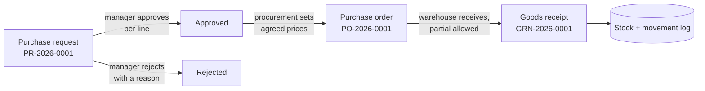

# VoltProcure

A procurement and inventory demo built on [Laravolt](https://github.com/laravolt/laravolt) 8. It shows what a small but real business system looks like on Laravel 13, Livewire 4, Preline 5 and Tailwind CSS 4.3.

A department asks for goods, its manager approves them line by line, procurement turns the approval into a purchase order, and the warehouse receives the delivery, in parts if needed. Stock updates itself and every movement is traced back to its document.



## What is in it

| Page | What it does |
|---|---|
| **Ringkasan** (dashboard) | Requests waiting for approval, open orders with overdue ones flagged, low stock, month-to-date spend against the same days last month, weekly order value for 8 weeks (with a table view), and a "your work" list that depends on your role |
| **Permintaan barang** | Status tabs, create as draft or submit, per-line approval, rejection with a required reason, document history |
| **Pesanan pembelian** | Create from an approved request at the agreed price, receive goods in parts, receipt history |
| **Stok barang** | Low-stock filter, search, reorder-point bar, movement history per item |
| **Pemasok** | Suppliers with open orders and total ordered |

Rules live in `app/Actions/Procurement` and are covered by tests:
- Only the department's manager decides.
- Nothing is ordered before approval.
- A receipt never exceeds what is still outstanding.
- Document numbers run per year (`PR-`, `PO-`, `GRN-`).

The UI is in Indonesian, because the demo's users are.

## Demo accounts

All passwords are `password`.

| Email | Role | Try this |
|---|---|---|
| `dewi@voltprocure.test` | Requester (IT) | Create a request and submit it |
| `bagus@voltprocure.test` | IT manager | Approve fewer items than requested, or reject |
| `andi@voltprocure.test` | Procurement | Turn an approved request into a PO |
| `siti@voltprocure.test` | Warehouse | Receive part of an order and watch stock move |

Other accounts: requesters `yoga`, `maya`, `fajar` and managers `wulan`, `hendra`, `ratna`, one per department.

The seeder replays two months of activity through the same actions the UI uses, so totals, statuses and stock always agree. Dates are relative to the day you seed.

## Run it locally

Requires PHP 8.5, Composer and Bun.

```bash
composer setup   # install, .env, key, migrate, build assets
php artisan db:seed
composer dev     # server, queue, logs and Vite together
```

## Run it with Docker (Octane + FrankenPHP)

The production image serves the app with [Laravel Octane](https://laravel.com/docs/octane) on [FrankenPHP](https://frankenphp.dev) in worker mode: each worker boots Laravel once and keeps it in memory.

```bash
cp .env.docker.example .env.docker
docker compose -f docker-compose.prod.yml run --rm --no-deps app php artisan key:generate --show   # paste into APP_KEY
docker compose -f docker-compose.prod.yml up -d --build
```

Open http://localhost:8090.
- **First start:** the container creates the SQLite database and seeds the demo.
- **Nightly reset:** with `APP_DEMO=true`, the `scheduler` service wipes and reseeds it every night at 00:00 WIB, so the dates stay current.
- **Reset by hand:** `docker compose -f docker-compose.prod.yml exec app php artisan demo:reset`.

In a short run on a shared 2-vCPU host with 2 workers, the dashboard served ~50 req/s (about 3,000 per minute) against ~15 req/s on `php artisan serve`, and `/up` ~950 req/s.

[DOCKER.md](DOCKER.md) covers:
- how the image is built;
- the performance settings (OPcache JIT, SQLite WAL, cookie sessions);
- the tuning knobs `OCTANE_WORKERS` and `OCTANE_MAX_REQUESTS`;
- the Laravolt version this setup needs.

## Design

The interface follows one direction, **"meja kerja rapi"** (a tidy desk): tidy, certain, a little warm.

- **Graphite neutrals, one accent.** Laravolt's views are written in `gray-*` and `blue-*`. `resources/css/app.css` maps those scales to zinc and to the brand indigo `#4F46E5`, so every page follows, including Laravolt's built-in user and role screens, without overriding a single vendor view.
- **One rich moment.** The dashboard's weekly order chart is the only decorated element. Everything else stays quiet.
- **Signature.** Every document number is set in tabular monospace (`PR-2026-0187`), so it reads as a reference you can quote over the phone.
- **Details.**
  - Numbers use tabular figures.
  - Hover styles apply only on devices that can hover.
  - Inputs are 16px on phones, so iOS does not zoom in.
  - Status badges always carry a label, never color alone.
  - The chart has a table view.

The direction was worked out with [unslop](https://github.com/heydamir/unslop) by [@heydamir](https://github.com/heydamir) (CC BY 4.0): audit, direction, then passes over spacing, color, type, copy, layout and details.

## Quality gates

```bash
composer test   # type coverage 100%, Pest, Pint, Rector, Prettier, PHPStan max
```

## Dependency status

VoltProcure currently tracks two unreleased fixes through VCS branches in `composer.json`:

| Package | Branch | Why |
|---|---|---|
| `laravolt/laravolt` | `chore/preline-5-tailwind-4.3` ([#474](https://github.com/laravolt/laravolt/pull/474)) | Preline 5 and Tailwind 4.3 assets. The branch already includes the Octane sidebar fix released in [v8.0.1](https://github.com/laravolt/laravolt/releases/tag/v8.0.1) |
| `laravolt/avatar` | `fix/cache-base64-as-string` ([#210](https://github.com/laravolt/avatar/pull/210)) | Authenticated pages return 500 with a persistent cache on Laravel 13 |

Running under Octane needs laravolt/laravolt v8.0.1 or later (or the branch above). Older versions grow the sidebar on every request, and in production every page after the first returns 500. See [DOCKER.md](DOCKER.md#octane-caveats).

Once both are released, replace them with normal version constraints and drop the `repositories` entries.

## License

MIT. Design direction credit: unslop by @heydamir, CC BY 4.0.
